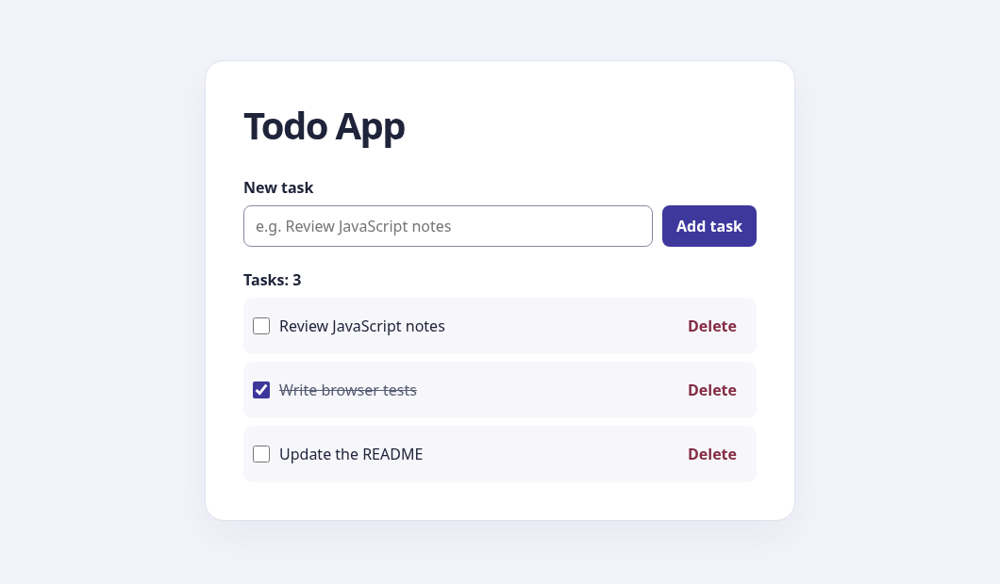

# Todo App

A small browser-based task list built with HTML, CSS, and vanilla JavaScript. I started it to practice DOM manipulation, event handling, and saving data in the browser.



## Features

- Add a task with the **Add task** button or **Enter**. Empty or whitespace-only entries are rejected.
- Check a task to complete it. Uncheck it to reopen it.
- Delete individual tasks and see the total number of tasks update.
- Keep task text and completion status after a reload using the browser's Local Storage.

Tasks are stored in the browser for the current site address. They do not sync across browsers or devices. Clearing the site's data removes the saved tasks. If storage is unavailable or a save fails, the app shows a message.

## Run locally

From the repository root, start a local server with Python 3:

```sh
python3 -m http.server 8000
```

Open [http://localhost:8000/todo-app/](http://localhost:8000/todo-app/). The app runs without a build step or npm installation.

## How it works

- [`index.html`](todo-app/index.html) defines the form, task list, and status messages.
- [`script.js`](todo-app/script.js) keeps tasks in an array of objects with a `text` field and a boolean `completed` field. Adding, checking, unchecking, or deleting a task saves the array as JSON. On page load, the script reads that JSON and recreates the list. Tasks from older text-only lists load as open.
- [`style.css`](todo-app/style.css) lays out the app and crosses out the text when its checkbox is checked.

## Run the tests

With Node.js 20 or newer, run the following from the repository root:

```sh
npm ci
npx playwright install chromium
npm test
```

The tests open the app in Chromium and exercise adding, completing, reopening, and deleting tasks across reloads. They also cover older saved lists and storage errors. Playwright is used only for tests.

To use an existing Chromium installation, set `TODO_TEST_CHROMIUM` to the path of its executable when running `npm test`.
